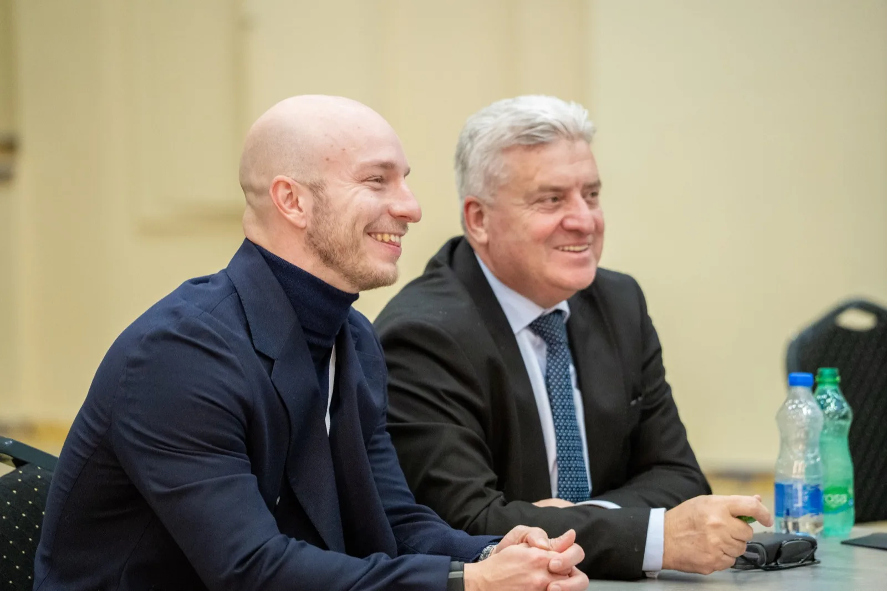
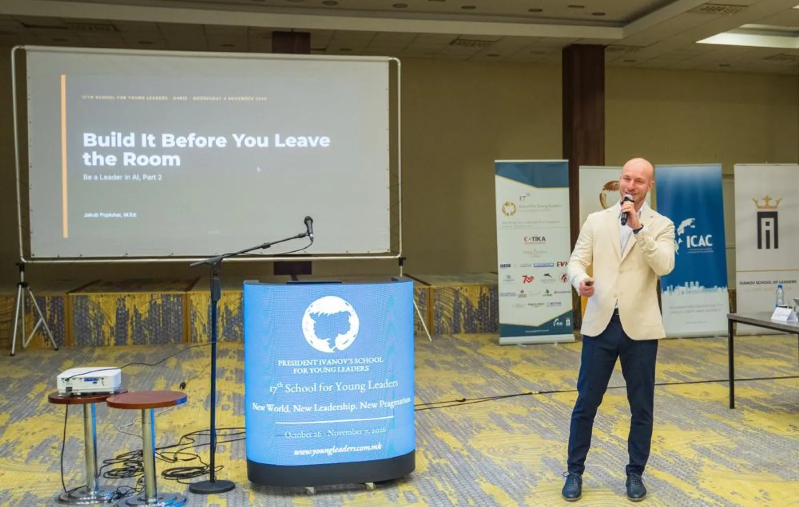
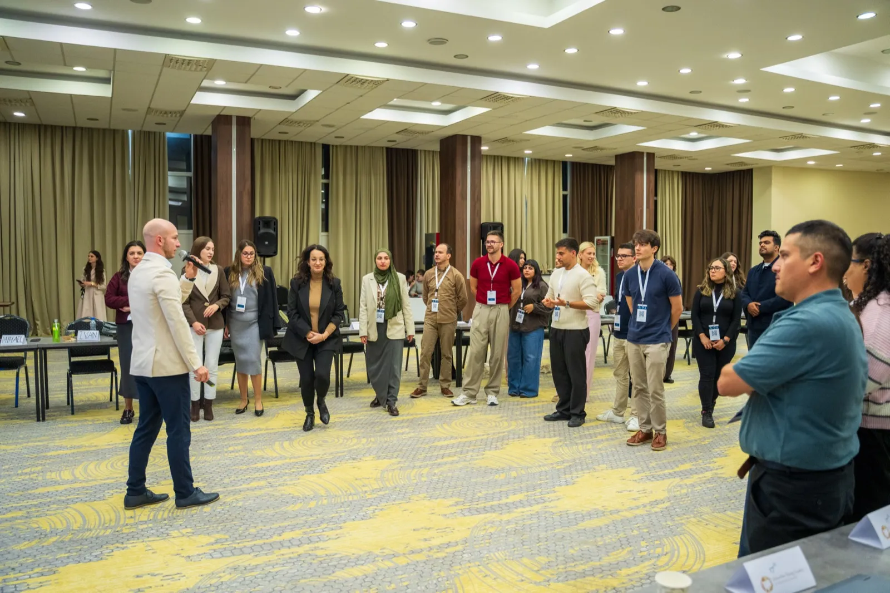
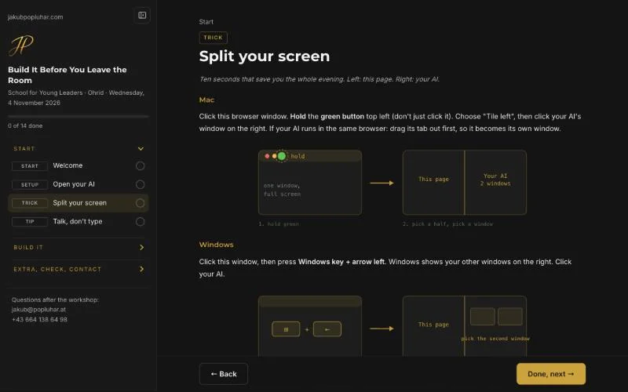
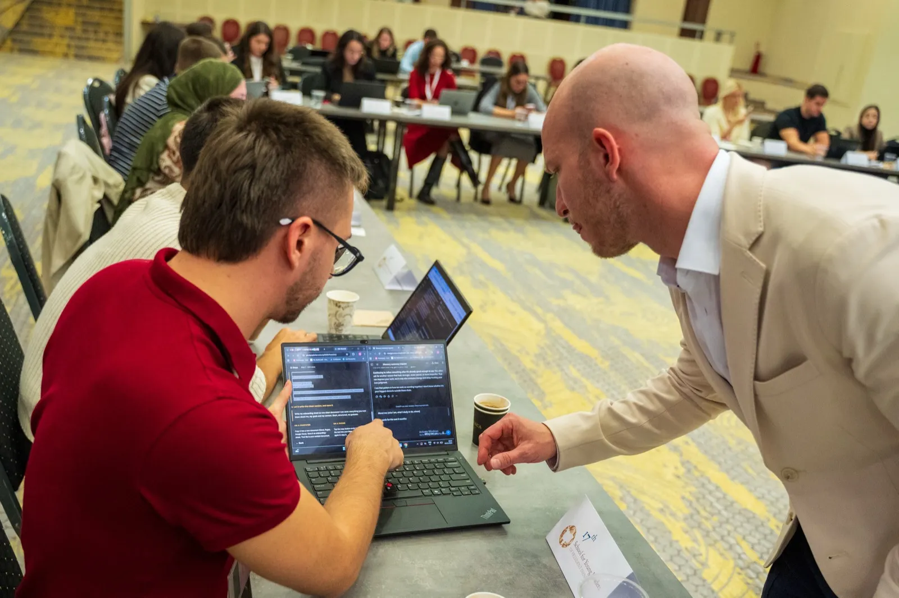
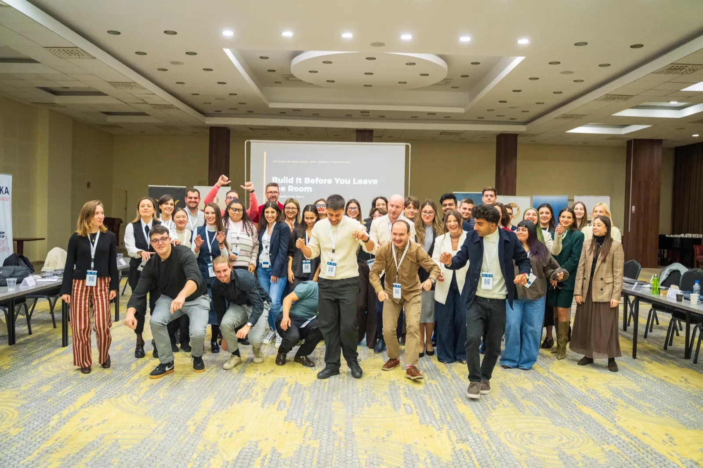

> **Kurz gesagt**
> In Ohrid haben 40 junge Führungskräfte in 90 Minuten ihren eigenen KI-Assistenten gebaut. Zu Beginn hatten 5 der 40 schon einmal ein Projekt in ChatGPT oder Claude angelegt. Am Ende hatten es alle 40. Das Design dahinter stammt aus mehr als 5.000 Stunden vor Gruppen: Der ganze Raum arbeitet gleichzeitig an den eigenen Bildschirmen, und der Trainer kann frei zwischen den Tischen herumgehen.

Montag, 2. November, 10:35, Ohrid, Nordmazedonien. Auf meinem Laptop: das Foto von meiner Website, aufgenommen vor einem Jahr in diesem Raum. Hinter dem Laptop: derselbe Raum, und diesmal saß ich im Publikum.

Im November 2025 habe ich bei der 16. Ausgabe der School for Young Leaders of President Ivanov gesprochen, über Konsumentenpsychologie und kurz über KI. Dieses Jahr hat mich die School wieder eingeladen, für einen Vortrag und einen Workshop, beide zu KI. Das Thema der 17. Ausgabe lautete "New World, New Leadership, New Pragmatism".

Seitdem hat sich so viel verändert. Meine 90 Minuten kamen am Mittwochabend. Davor habe ich zugehört.

Die School for Young Leaders ist das Projekt von Dr. Gjorge Ivanov, Präsident Mazedoniens von 2009 bis 2019. Seit 2010 holt sie junge Menschen nach Ohrid, zu Vorträgen, Simulationen und Trainings zum Thema Führung: rund 600 Teilnehmende in den ersten 15 Ausgaben, unterrichtet von etwa 400 Vortragenden. Darunter waren der frühere tschechische Präsident Václav Klaus, Katalin Novák, Präsidentin Ungarns von 2022 bis 2024, Djordjija Petkoski von der Wharton School und Kurt Volker, ehemaliger US-Botschafter bei der NATO. Zu den Speakern in diesem Jahr gehörte [Cordell Carter](https://www.linkedin.com/in/cordellcarterii/), Gründer und CEO des Project on Belonging.

## Was lernt man als Speaker, wenn man selbst im Publikum sitzt?

[Anastasija Ilievska](https://www.linkedin.com/in/anastasija-ilievska-dea/) leitete eine Session über das Reden vor Publikum. Ihr Kernpunkt war Authentizität, dazu eine einfache Regel: Eröffne nie mit dem Zitat eines anderen. Ein berühmter Satz auf Folie eins fühlt sich sicher an. Es ist eine geliehene Stimme, und der Raum lernt den Autor kennen, bevor er dich kennenlernt.

Am Mittwoch gehörte der Vormittag [Emanuel Stadler](https://www.linkedin.com/in/estadler/): um 10:30 ein Vortrag, "Who Decides? Leadership in the Age of AI", und um 11:45 ein Workshop, "The AI Decision Lab". Seine beiden Foliensätze hatte ich am Abend davor gelesen. Auf seiner letzten Folie stand: "Who decides? You just did. Tonight, 18:00: Jakub Popluhar shows how to turn this into your own AI tools."

Meine erste Folie um 18:00 war also seine. Und als ich erklärt habe, was einen KI-Agenten zum Agenten macht, habe ich seine fünf Wörter verwendet: Instructions (Anweisungen), Verification (Prüfung), Limits (Grenzen), Owner (Verantwortliche), Access (Zugriff). Der Raum kannte sie schon vom Vormittag. Was Emanuel bereits behandelt hatte, etwa Beispiele für Halluzinationen, kam in meinen Folien nicht vor.

Die Regel dahinter: In einem Programm mit mehreren Speakern liest du am Abend davor die anderen Foliensätze und baust auf dem auf, was der Raum schon hat. Sessions, die an die vorherige anknüpfen, vermitteln mehr als fünf voneinander getrennte Vorträge.

## Wie eröffnest du die letzte Session eines langen Tages?

18:00 war der letzte Slot, nach Emanuels zwei Sessions und Colin Sniders "Timeless Values in New Contexts". Abendessen um 19:30, ein festes Ende.

Ein Raum braucht um diese Uhrzeit keine weiteren Folien. Deshalb stand auf meiner ersten Folie nach dem Titel "Everybody stand up", und die nächsten sechs waren ein Spiel: Chatbot oder Agent, Abstimmung mit den Füßen. Die linke Seite des Raums für "er redet", die rechte für "er handelt".

Fünf Runden, von "Er schreibt deiner Professorin eine E-Mail" bis zu einem echten Fall: einem Agenten, den ich für FRESH nutze, mein Roundnet-Event. Rund 1.200 Fotos rein, ein Instagram-Karussell, ein 18-Sekunden-Reel und drei Textvorschläge für die Caption raus.

Diesen Agenten habe ich mit Emanuels fünf Wörtern erklärt. Instructions: die Markenregeln. Verification: Bild und Text müssen dasselbe sagen. Limits: was er nie postet. Owner: ich, ich wähle aus und ich poste. Access: das Fotoarchiv, nicht der Instagram-Account.

## Was haben 40 junge Führungskräfte in 90 Minuten gebaut?

Ich kannte den Raum, bevor ich ihn betreten habe. Eine Woche vorher hatten 40 Teilnehmende online einen KI-Check mit fünf Fragen gemacht. Ihre Tools: ChatGPT 34, Gemini 22, Claude 18, Copilot 15. Jeder Prompt auf der Workshop-Seite musste also in allen vier funktionieren. Und 11 der 40 hatten als Weg zur nützlichsten Antwort die Option "ein möglichst langer Prompt" angekreuzt. Diese Zahl kam auf eine Folie: Die KI brauchte keinen längeren Prompt, sie brauchte deine Ziele.

Eine Frage zu Beginn zeigte, wo der Raum stand: Wer hat schon einmal ein Projekt in ChatGPT oder Claude angelegt? Fünf Hände von 40. Am Ende des Abends waren es 40 von 40.

Das Versprechen stand im Titel, Build It Before You Leave the Room, und auf einer Folie. Ein KI-Assistent mit Namen, der deine Ziele kennt. Ein einseitiger Plan für ein echtes Ziel, mit einem ersten Schritt und einem Datum. Ein Montagsritual, das ihn am Leben hält. Die ersten beiden waren das Minimum.

Die Workshop-Seite führte Schritt für Schritt dorthin, egal welches der vier Tools jemand nutzte. Sie bleibt online, damit sich jeder Schritt zu Hause abschließen lässt.

## Warum arbeiten die Teilnehmenden am eigenen Bildschirm?

Weil niemand auf die nächste Folie warten soll. In Ohrid hat niemand einen Prompt von der Leinwand abgeschrieben: Alle arbeiteten in ihrer eigenen KI, am Laptop oder am Handy, in jeder Sprache, in der sie denken, auf Mazedonisch, Englisch oder in gemischten Sätzen. Wie die Seite gebaut ist, damit das funktioniert, ist der Teil meines Workshop-Designs, den ich für den Raum behalte.

Jede Tool-Einführung und jede Onboarding-Session steht vor derselben Wahl: die Schritte auf einer Folie vorne oder direkt neben der Arbeit.

## Was macht der Trainer, während der Raum baut?

Während der Bauphase bin ich von Tisch zu Tisch gegangen, zu Laptops und Handys, und war still. Wer zurücklag, wusste, was das Minimum war, und wer früher fertig war, hatte mehr zu tun. Der Raum hat einfach weitergearbeitet. Während sie getippt haben, hatte ich Zeit.

Eine Regel stand für alle auf der Folie: Patientenakten, Kundendaten und interne Dokumente kommen nie in eine KI.

## Wie bereite ich einen Workshop vor?

Jedes Gruppentraining, das ich gebe, läuft durch einen Preflight, einen Skill, den ich genau dafür gebaut habe. Zwei Dinge daraus: Ein Skript prüft die Workshop-Seite schon vor dem Tag, und was vorne läuft, ist genau das, was der Raum baut. Ein Assistent, ein Prompt.

Das Foto gehört zum Plan, es ist keine Nebensache. In Ohrid hatte es am Ende seine eigene Folie, "Group photo. Then dinner, on time, as promised.", und einen Fotografen. Am Ende sind wir ihm entgegengetanzt.

## Wo hat lokale KI in einem Workshop ihren Platz?

Gegen Ende hat ein Modell auf meinem eigenen MacBook Pro, zu Hause in Wien, live sechs erfundene Lebensläufe geprüft, in 86 Sekunden. Kein Lebenslauf hat diesen Rechner verlassen. Fünf Ergebnisse waren richtig. Bei einem HR-Fachdiplom ohne Studienabschluss lautet die richtige Antwort "bitte prüfen", weil ein Mensch über die Gleichwertigkeit entscheidet. Das lokale Modell schrieb "nicht erfüllt", identisch in allen vier Durchläufen, während Claude in der Cloud am Vortag "bitte prüfen" gesagt hatte.

Das war ein Modell mit 35 Milliarden Parametern auf einem Laptop, kein Firmenserver. Lokal löst, wohin die Daten gehen. Es löst nicht, wer entscheidet. (Den ganzen Vergleich findest du in meinem Artikel über [lokale KI und Cloud-KI](/blog/lokale-ki-bewerbungen/).)

## Was heißt es, in derselben Woche Speaker zu sein und selbst zu lernen?

Am Montag hat mir eine Speakerin beigebracht, wie man eröffnet. Am Mittwoch hat mir ein Speaker meine erste Folie in die Hand gegeben. Am Abend hat ein Raum mit 40 jungen Führungskräften eigene Assistenten gebaut, während ich zwischen den Tischen herumging und still war.

**Die beste Vorbereitung auf die Bühne ist ein Platz im Publikum.**

## Häufige Fragen

### Was ist die School for Young Leaders of President Ivanov?
Ein Leadership-Programm in Ohrid, Nordmazedonien, 2010 gegründet von Dr. Gjorge Ivanov, Präsident Mazedoniens von 2009 bis 2019. Die Teilnehmenden bekommen Vorträge, Simulationen und Praxistrainings zu Führung in Wirtschaft, Politik und Militär. Rund 600 junge Menschen haben an den ersten 15 Ausgaben teilgenommen, mit etwa 400 Vortragenden, darunter der frühere tschechische Präsident Václav Klaus und die frühere ungarische Präsidentin Katalin Novák. Die 17. Ausgabe 2026 stand unter dem Thema "New World, New Leadership, New Pragmatism".

### Wie führst du einen Hands-on-KI-Workshop mit 40 Personen durch?
Indem du zuerst den Raum gestaltest und dann die Folien. Nach mehr als 5.000 Stunden vor Gruppen fließt der Großteil meiner Vorbereitung in eine Frage: Wie arbeiten 40 Menschen gleichzeitig, ohne auf das zu warten, was vorne passiert? In Ohrid hatten vor dem Workshop 5 von 40 Teilnehmenden ein Projekt in ChatGPT oder Claude angelegt. 90 Minuten später waren es 40 von 40.

### Wie sorgst du dafür, dass 40 Personen gleichzeitig arbeiten?
Alle arbeiten am eigenen Bildschirm, mit der eigenen KI, statt einer Folie vorne zu folgen. Wie die Schritte gebaut sind, damit niemand zurückfällt, ist der Teil meines Workshop-Designs, den ich für den Raum behalte. Das Ergebnis in Ohrid: 40 von 40 gingen mit einem funktionierenden Assistenten aus dem Raum.

### Wie hältst du eine gemischte Gruppe im KI-Workshop zusammen?
Mit einem Minimum, das alle erreichen, und mehr für die Schnelleren. In Ohrid war das Minimum ein KI-Assistent mit Namen, der deine Ziele kennt. Gemischte Gruppen sind mein Alltag: Wer sich kaum anmelden kann, sitzt am selben Tisch wie der Profi, und beide gehen mit etwas nach Hause, das sie nutzen.

### Können Teilnehmende an einem Abend ihren eigenen KI-Assistenten bauen?
Ja. In Ohrid haben 40 junge Führungskräfte das in 90 Minuten geschafft, in der KI, die sie ohnehin nutzten: ChatGPT, Gemini, Claude oder Copilot. Jeder Assistent hat einen Namen, kennt die Ziele der Person, der er gehört, und bekommt einen wöchentlichen Check-in. Die Workshop-Seite bleibt online, damit sich jeder Schritt zu Hause abschließen lässt.

### Kann ein lokales KI-Modell Lebensläufe richtig prüfen?
Nicht ohne menschliche Prüfung. In einer Live-Demo hat ein Modell mit 35 Milliarden Parametern auf meinem Laptop sechs erfundene Lebensläufe in 86 Sekunden geprüft und fünf richtig bewertet. Beim sechsten, einem HR-Fachdiplom ohne Studienabschluss, schrieb es in allen vier Durchläufen "nicht erfüllt", wo die richtige Antwort "bitte prüfen" gewesen wäre. Das war ein Laptop, kein Firmenserver, es sagt also nichts über lokale KI im Allgemeinen: Lokal löst, wohin die Daten gehen, nicht, wer entscheidet.
