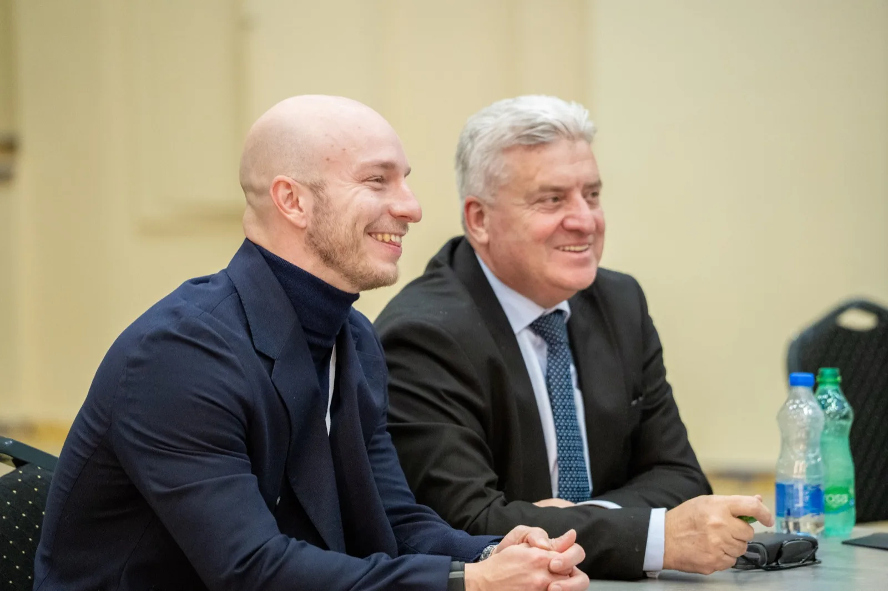
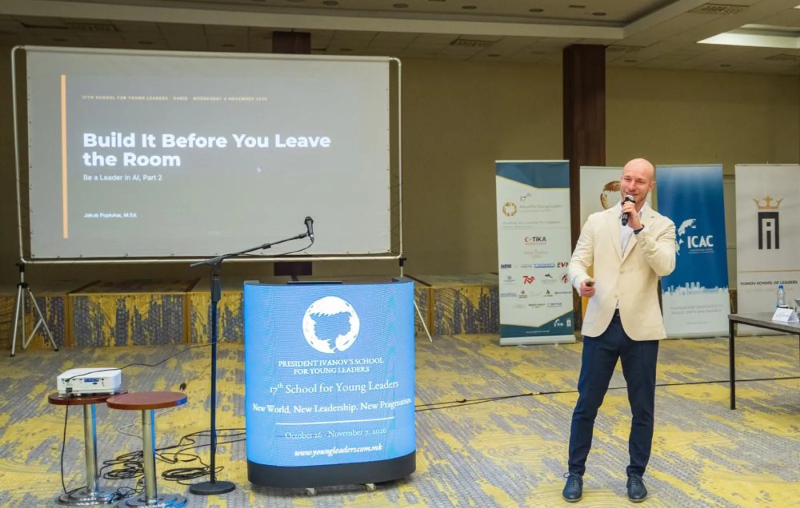
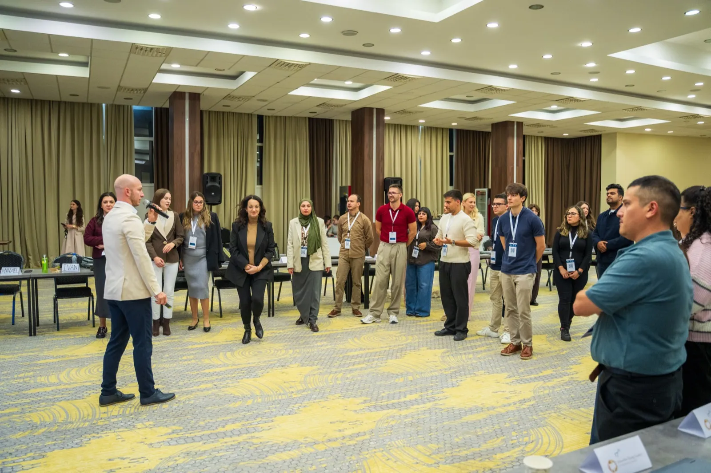
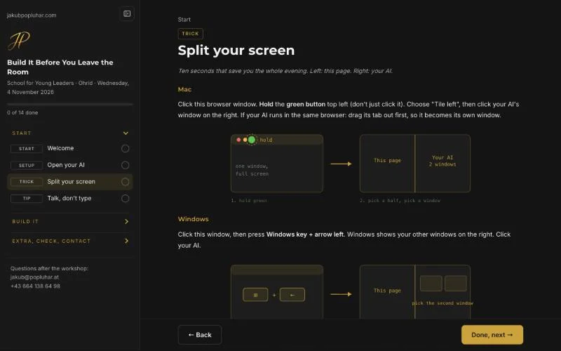
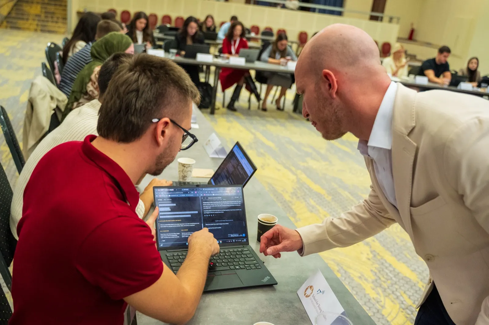
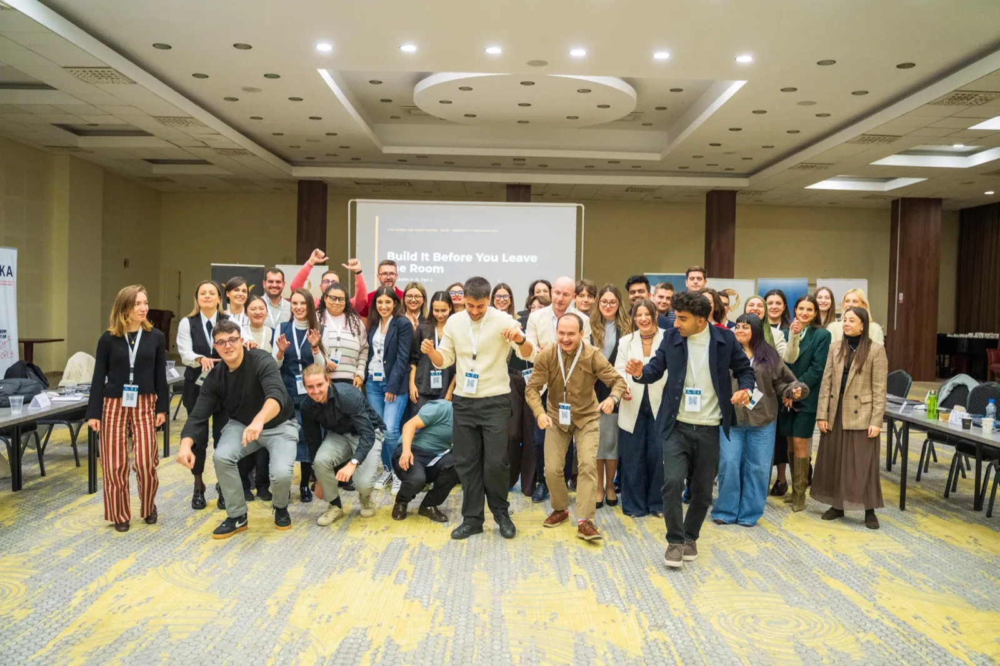

> **In short**
> In Ohrid, 40 young leaders built their own AI assistant in 90 minutes. At the start, 5 of the 40 had ever set up a project in ChatGPT or Claude. At the end, all 40 had. The design behind it comes from more than 5,000 hours in front of groups: the whole room works on its own screens at the same time, and the trainer is free to walk between the tables.

Monday, 2 November, 10:35, Ohrid, North Macedonia. On my laptop: the photo from my website, taken in this room a year ago. Behind the laptop: the same room, and this time I was in the audience.

In November 2025 I spoke at the 16th School for Young Leaders of President Ivanov, about consumer psychology and briefly about AI. This year the school invited me back for a lecture and a workshop, both on AI. The theme of the 17th edition was New World, New Leadership, New Pragmatism.

So much has changed since then. My 90 minutes came on Wednesday evening. Before that, I listened.

The School for Young Leaders is the project of Dr. Gjorge Ivanov, President of Macedonia from 2009 to 2019. Since 2010 it has brought young people to Ohrid for lectures, simulations and trainings in leadership: around 600 participants in its first 15 editions, taught by about 400 lecturers. Among them were former Czech President Václav Klaus, Katalin Novák, President of Hungary from 2022 to 2024, Djordjija Petkoski of the Wharton School and Kurt Volker, former US Ambassador to NATO. This year's speakers included [Cordell Carter](https://www.linkedin.com/in/cordellcarterii/), founder and CEO of the Project on Belonging.

## What does a speaker learn from sitting in the audience?

[Anastasija Ilievska](https://www.linkedin.com/in/anastasija-ilievska-dea/) ran a session on public speaking. Her key point was authenticity, with one plain rule attached: never open with somebody else's quote. A famous line on slide one feels safe. It is a borrowed voice, and the room meets the author before it meets you.

On Wednesday [Emanuel Stadler](https://www.linkedin.com/in/estadler/) gave the morning: a lecture at 10:30, "Who Decides? Leadership in the Age of AI", and a workshop at 11:45, "The AI Decision Lab". I had read both of his decks the evening before. His last slide read: "Who decides? You just did. Tonight, 18:00: Jakub Popluhar shows how to turn this into your own AI tools."

So my first slide at 18:00 was his. And when I explained what makes an AI agent an agent, I used his five words: Instructions, Verification, Limits, Owner, Access. The room already had them from the morning. What he had covered, such as hallucination examples, stayed out of my deck.

The rule behind it: in a programme with several speakers, read the other decks the night before and build on what the room already has. Sessions that pick up the last one teach more than five separate talks.

## How do you open the last slot of a long day?

18:00 was the last slot, after Emanuel's two sessions and Colin Snider's "Timeless Values in New Contexts". Dinner at 19:30, a hard stop.

A room at that hour does not need more slides. So my first slide after the title said "Everybody stand up", and the next six were a game: chatbot or agent, vote with your feet. Left side of the room for "it talks", right side for "it acts".

Five rounds, from "It writes an email to your professor" to a real one: an agent I use for FRESH, my roundnet event. About 1,200 photos in, an Instagram carousel, an 18-second reel and three caption options out.

I explained that agent with Emanuel's five words. Instructions: the brand rules. Verification: image and text must say the same. Limits: what it never posts. Owner: me, I choose and I post. Access: the photo archive, not the Instagram account.

## What did 40 young leaders build in 90 minutes?

I knew the room before I entered it. A week earlier, online, 40 participants had taken a five-question AI check. Their tools: ChatGPT 34, Gemini 22, Claude 18, Copilot 15. So every prompt on the workshop page had to work in all four. And 11 of the 40 had picked "the longest prompt possible" as the way to the most useful answer. That number went on a slide: it didn't need a longer prompt, it needed your goals.

One question at the start showed where the room stood: who has already set up a project in ChatGPT or Claude? Five hands out of 40. By the end of the evening it was 40 out of 40.

The promise was in the title, Build It Before You Leave the Room, and on one slide. A named assistant that knows your goals. A one-page plan for one real goal, with a first step and a date. A Monday ritual that keeps it alive. The first two were the minimum.

The workshop page led there step by step, in whichever of the four tools each person used. It stays online, so every step can be finished at home.

## Why does the work happen on the participant's own screen?

Because nobody should wait for the next slide. In Ohrid, nobody copied a prompt off the screen at the front: everyone worked in their own AI, on a laptop or a phone, in any language they think in, Macedonian, English or mixed sentences. How the page is built so that this works is the part of my workshop design I keep for the room.

Every tool rollout and every onboarding session faces the same choice: the steps on a slide at the front, or next to the work.

## What does the trainer do while the room builds?

During the build I went from table to table, to laptops and phones, and stayed quiet. Whoever was behind knew what the minimum was, and whoever finished early had more to do. The room got on with it. While they typed, I had time.

One rule stood on the slide for everyone: patient files, client data and internal documents never go into an AI.

## How do I prepare a workshop before the day?

Every group training I give runs through a preflight, a skill I built for exactly this. Two things from it: a script checks the workshop page before the day, and what runs at the front is exactly what the room builds. One assistant, one prompt.

The photo is part of the plan, not an afterthought. In Ohrid it had its own slide at the end, "Group photo. Then dinner, on time, as promised.", and a photographer. We ended up dancing towards him.

## Where does a local AI fit into a workshop?

Near the end, a model on my own MacBook Pro at home in Vienna screened six invented CVs live, in 86 seconds. No CV left that machine. Five results were right. On a professional HR diploma with no degree, the correct answer is "please check", because a person decides on equivalence. The local model wrote "does not meet", the same in all four of its runs, while Claude in the cloud had said "please check" the day before.

That was a 35-billion-parameter model on a laptop, not a company server. Local solves where the data goes. It doesn't solve who decides. (The full comparison is in my article on [local vs cloud AI](/en/blog/local-ai-job-applications/).)

## What does it mean to be a speaker and a learner in the same week?

On Monday a speaker taught me how to open. On Wednesday another one handed me my first slide. In the evening, a room of 40 young leaders built their own assistants while I walked between the tables and kept quiet.

**The best preparation for the front of a room is a seat in it.**

## Frequently asked questions

### What is the School for Young Leaders of President Ivanov?
A leadership programme in Ohrid, North Macedonia, founded in 2010 by Dr. Gjorge Ivanov, President of Macedonia from 2009 to 2019. Participants get lectures, simulations and practical trainings in business, political and military leadership. Around 600 young people took part in its first 15 editions, with about 400 lecturers, among them former Czech President Václav Klaus and former Hungarian President Katalin Novák. The 17th edition in 2026 ran under the theme New World, New Leadership, New Pragmatism.

### How do you run a hands-on AI workshop for 40 people?
By designing the room before the slides. After more than 5,000 hours in front of groups, most of my preparation goes into one question: how do 40 people work at the same time without waiting for the front? In Ohrid, 5 of 40 participants had set up a project in ChatGPT or Claude before the workshop. 90 minutes later, it was 40 of 40.

### How do you make sure 40 people are working at the same time?
Everyone works on their own screen, with their own AI, instead of following a slide at the front. How the steps are built so that nobody falls behind is the part of my workshop design I keep for the room. The result in Ohrid: 40 of 40 left with a working assistant.

### How do you keep a mixed group together in an AI workshop?
With a minimum everyone reaches and more for those who are faster. In Ohrid the minimum was a named assistant that knows your goals. Mixed groups are my everyday work: the person who can barely log in and the professional sit at the same table, and both leave with something they use.

### Can participants build their own AI assistant in one evening?
Yes. In Ohrid, 40 young leaders did it in 90 minutes, in whichever AI they already used: ChatGPT, Gemini, Claude or Copilot. Each assistant has a name, knows its owner's goals and gets a weekly check-in. The workshop page stays online, so every step can be finished at home.

### Can a local AI model screen CVs correctly?
Not without a human check. In a live demo, a 35-billion-parameter model on my laptop screened six invented CVs in 86 seconds and got five right; on the sixth, a professional HR diploma with no degree, it wrote "does not meet" in all four runs, where the right answer was "please check". That was a laptop, not a company server, so it says nothing about local AI in general: local solves where the data goes, not who decides.
